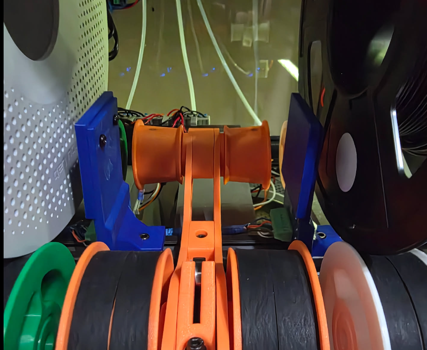
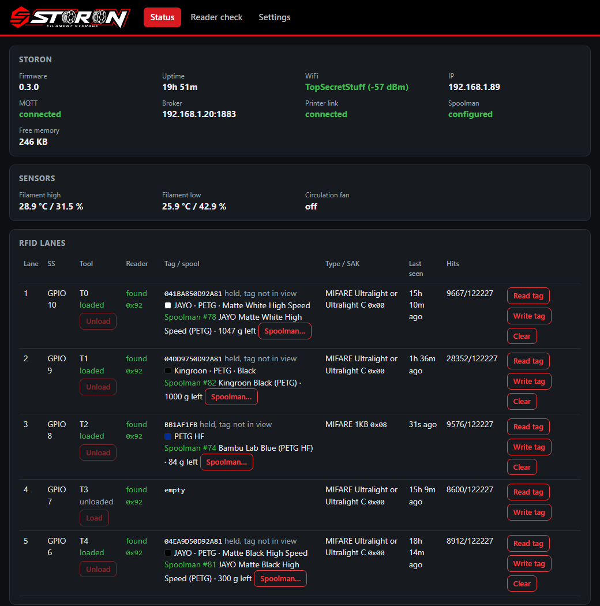
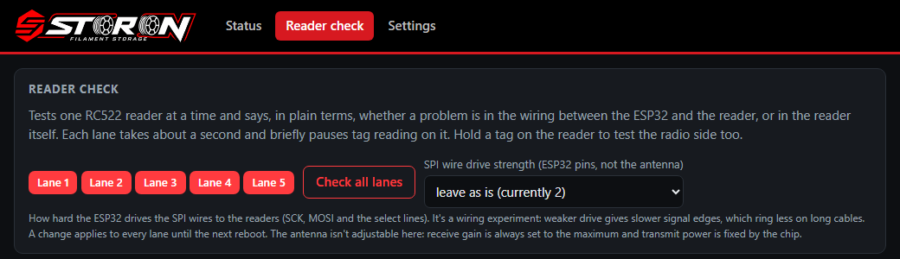
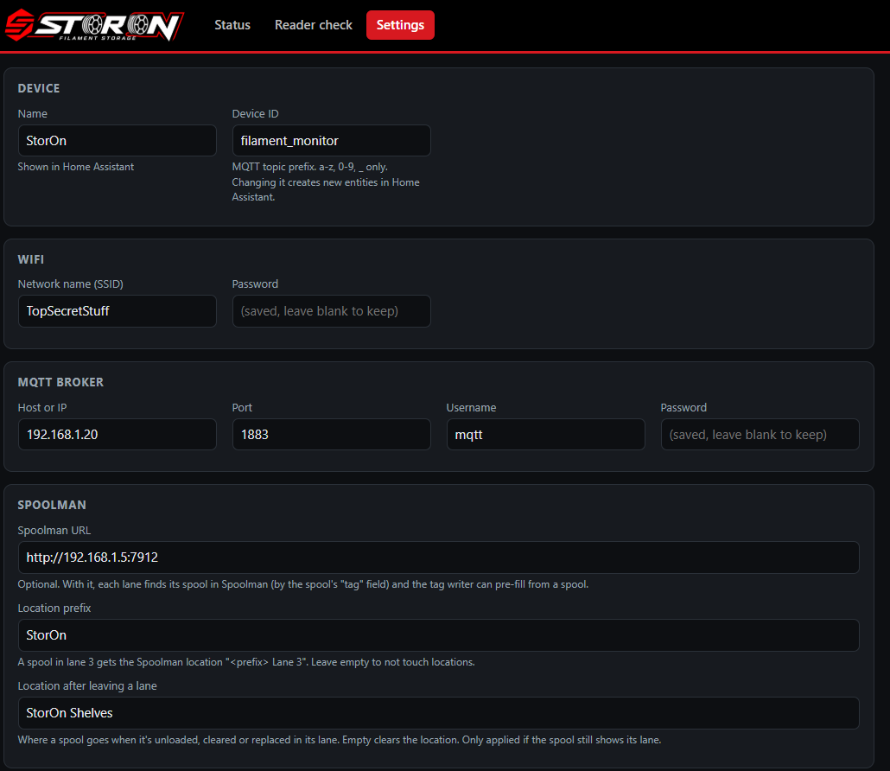
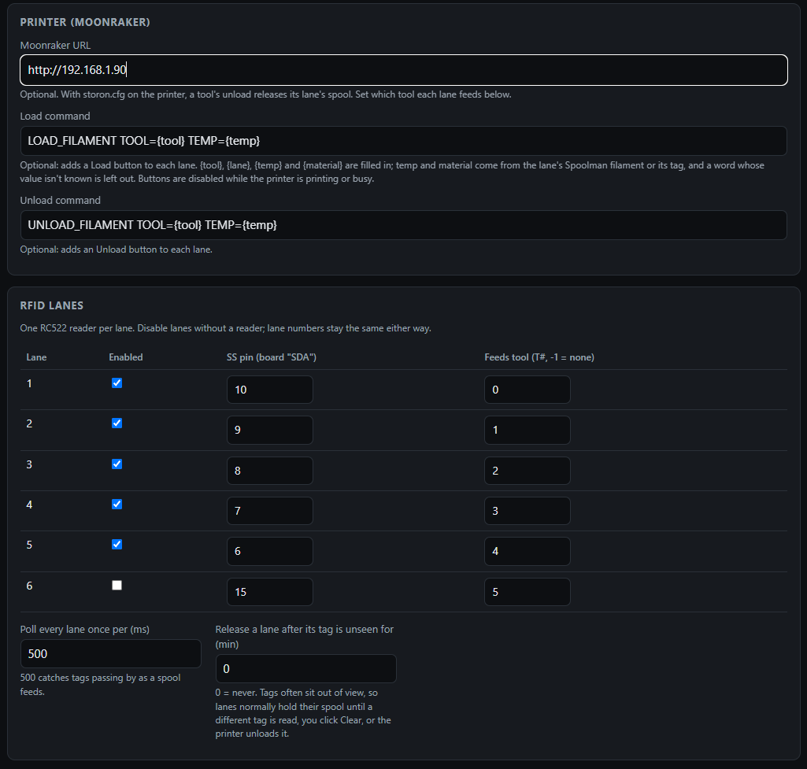

# StorOn ESP32 (inside the cabinet)

An ESP32-S3 inside the stand that watches the filament and the spools:

- **Humidity and temperature** at the top and bottom of the cabinet, plus a timed circulation fan, all in Home Assistant over MQTT.
- **An RFID reader per lane** that reads the spool's tag: **Bambu Lab** tags (read-only) and **OpenTag3D** stickers (read and write).
- **Spoolman sync:** a spool's location follows it into and out of the lanes, and you can link or create spools from the tag.
- **Printer link (optional):** Load/Unload buttons, and each tool's spool is shared with OrcaSlicer and HelixScreen through Moonraker.
- **Web UI** for setup and status. No code edits or PlatformIO needed.

**Quick start**

1. Flash `storon-vX.Y.Z-full.bin` from [Releases](https://github.com/astechevolves/storon/releases) at offset `0x0` (for example with [ESP Web Flasher](https://espressif.github.io/esptool-js/)).
2. Join the `StorOn-Setup-XXXX` WiFi (password `storonsetup`). The settings page opens.
3. Enter WiFi, MQTT, and which lanes have readers, then **Save and reboot**.
4. Open http://filament-monitor.local/

Everything below is the detail: [hardware](#hardware), [reader wiring](#reader-wiring-cat5), [install](#installing-the-firmware), [setup](#setup), [web UI](#web-ui), [spool tags](#spool-tags), [Spoolman](#spoolman), [printer](#printer-link-moonraker), [Home Assistant](#home-assistant-mqtt), [API](#json-api), [building](#building-from-source), [limitations](#known-limitations), [references](#references).

---

## Hardware

- ESP32-S3 DevKitC-1, **N16R8** (16 MB flash, 8 MB PSRAM)
- RC522 RFID reader per lane, with a ferrite sheet behind each so it reads only its own spool: [the ones used here](https://a.co/d/05OYSE5E) (6-pack, 3.3 V, SPI)
- 2× DHT22 (top and bottom of the cabinet)
- Circulation fan (PWM) and the onboard WS2812 status LED
- NTAG215 stickers (25 mm) for spools without a Bambu tag, written as OpenTag3D: [the ones used here](https://a.co/d/06WTXhvL) (60-pack, 10 anti-metal and 50 standard)

Default pins (all can be changed on the Settings page; use `-1` for anything not fitted):

| Function | GPIO |
|---|---|
| DHT22 top / bottom | 4 / 5 |
| Fan | 14 |
| Status LED | 48 (38 on DevKitC-1 v1.1) |
| SPI SCK / MISO / MOSI | 12 / 13 / 11 |
| Lane 1–6 SS ("SDA" on the RC522) | 10, 9, 8, 7, 6, 15 |

All readers share the SPI bus. Each lane has its own SS pin.

### Reader wiring (Cat5)

**Short version:** two Cat5 cables, each daisy-chained through up to 3 readers. Each reader has an 8-pin screw terminal soldered in place of its header. Each cable's clock line has a 39 Ω resistor at the ESP32 end. The readers are powered from the ESP32's 3V3 pin.

Both cables are wired the same way except for the SS pins:

| Cat5 wire | Signal | RC522 pin | Cable 1 (lanes 1–3) | Cable 2 (lanes 4–6) |
|---|---|---|---|---|
| Orange | SCK | SCK | GPIO 12 through 33–47 Ω (39 Ω used) | GPIO 12 through its own 33–47 Ω |
| White/Orange | GND | GND | GND | GND |
| Green | MOSI | MOSI | GPIO 11 | GPIO 11 |
| White/Green | 3.3 V | 3.3V | ESP32 3V3 | ESP32 3V3 |
| Blue | MISO | MISO | GPIO 13 | GPIO 13 |
| White/Blue | SS, 1st reader | SDA | GPIO 10 (lane 1) | GPIO 7 (lane 4) |
| Brown | SS, 2nd reader | SDA | GPIO 9 (lane 2) | GPIO 6 (lane 5) |
| White/Brown | SS, 3rd reader | SDA | GPIO 8 (lane 3) | GPIO 15 (lane 6, spare with 5 readers) |

Each color is twisted with its white-striped partner, so SCK shares a pair with GND, which keeps the clock clean.

**At each reader**
- Solder an 8-position 2.54 mm screw terminal into the RC522's header holes ([these](https://a.co/d/07W0wmXX), 8P size).
- Strip a 3–4 cm window of jacket without cutting the cable. Cut only the five bus wires and this reader's SS wire. Leave the other SS wires running on to their readers.
- Put the incoming and outgoing ends of each bus wire in the same terminal. This reader's SS wire goes alone in SDA.
- Jumper RST to 3.3V. Leave IRQ empty.
- Zip-tie the cable to the mount for strain relief, and recheck the screws after a day or two. Don't tin the solid wire ends.

**At the ESP32**
- The ESP32-S3 sits on a [44-pin screw-terminal breakout](https://a.co/d/06jYdxeh).
- Join both cables' MOSI to GPIO 11 and MISO to GPIO 13. Each cable's SCK goes to GPIO 12 through its own 39 Ω series resistor.
- Both white/green wires go to the ESP32's 3V3 pin, and both white/orange wires go to GND.
- Five readers on the DevKit's 3V3 regulator has worked so far, but it's near the regulator's limit with WiFi active. If readers drop out or the board resets, feed the readers from a separate 3.3 V supply instead. Tie its ground to the ESP32's GND, and put a 470 µF capacitor across it where the reader feed starts.



*Rev 1 reader holders (blue), one beside each lane, facing the side of the spool.*

## Installing the firmware

Prebuilt firmware is on the [Releases](https://github.com/astechevolves/storon/releases) page.

- **First install** on a blank board: flash `storon-vX.Y.Z-full.bin` at `0x0`, in Chrome or Edge with [ESP Web Flasher](https://espressif.github.io/esptool-js/), or with
  `esptool.py --chip esp32s3 write_flash 0x0 storon-vX.Y.Z-full.bin`.
- **Updating:** upload `storon-vX.Y.Z-update.bin` on the Settings page under **Firmware update**. Settings and spool links are kept.

## Setup

1. On first boot, or if the saved WiFi can't be reached, the board starts a hotspot `StorOn-Setup-XXXX` (password `storonsetup`). Join it and the settings page opens; if it doesn't, browse to http://192.168.4.1/settings.
2. Fill in the settings and **Save and reboot**.
3. The UI is then at `http://<device-id>.local/` (the device ID with `_` changed to `-`, so http://filament-monitor.local/ by default) or at the board's IP address.

Settings, grouped as on the page:

| Group | What it sets |
|---|---|
| Device | Name shown in Home Assistant. Device ID used for MQTT topics and the hostname. |
| WiFi / MQTT broker | Network and broker login. |
| Spoolman | Spoolman URL. Location name for spools in a lane (`StorOn` by default, so `StorOn Lane 3`). Optional location for a spool that leaves a lane (empty clears it). |
| Printer (Moonraker) | Moonraker URL. Load and Unload G-code for the lane buttons (see [Printer link](#printer-link-moonraker)). |
| RFID lanes | Six lane slots. Per lane: reader fitted, SS pin, and which tool (`T` number) it feeds. Lane numbers stay fixed when others are disabled. |
| Pins | DHT, fan, LED, SPI. A pin can't be used twice. |
| Timing | Sensor interval (30 s), fan every 60 min for 5 min, RFID poll cycle (500 ms), lane release timeout (0 = never), LED brightness. |
| Web UI password | Optional, user `admin`. |
| Maintenance | Firmware update, reboot, factory reset. |

Holding the **BOOT** button for 10 seconds also does a factory reset.

To pre-fill WiFi and MQTT at build time, copy `include/config.example.h` to `include/config.h`.

## Web UI

**Status** (`/`)
- Device, WiFi/MQTT and printer state, sensor readings, fan, and an event log.
- One row per RFID lane: reader found, current tag, decoded spool, linked Spoolman spool, and the tool it feeds.
- Lane buttons:
  - **Read tag:** dumps the tag (UID, type, SAK, readable memory).
  - **Write tag:** writes an OpenTag3D sticker. It can pre-fill from a Spoolman spool and save the tag ID back to it.
  - **Spoolman:** links the lane's tag to an existing spool, or creates a new spool from the tag data. A new roll on a reusable spool can take over the tag, and the old spool can be archived.
  - **Load / Unload:** sends the configured G-code for the lane's tool.
  - **Mark loaded / Mark unloaded:** only corrects the recorded state. Nothing moves.
  - **Clear:** forgets the lane's current tag.



**Readers** (`/readers`): tests one RC522 at a time and says whether a problem is in the wiring or in the reader itself.



**Settings** (`/settings`): everything in the table above.





## Spool tags

Each lane polls its reader and decodes the tag facing it.

**Bambu Lab spools** (MIFARE Classic 1K), **read-only**
- Sector keys are derived from the tag UID (HKDF-SHA256), following the Bambu Research Group's published work (see [References](#references)).
- Decoded fields: material and variant, detailed type (e.g. "PLA Basic"), color, spool weight, length, diameter, nozzle range, bed temperature, drying temperature and time, production date, and `tray_uuid`.
- The spool is identified by `tray_uuid`. It's the same ID the AMS reports and OpenSpoolMan stores in Spoolman's `tag` field, so spools already set up with OpenSpoolMan match.
- The data is RSA-signed by Bambu, so these tags can't be rewritten.

**OpenTag3D stickers** (NTAG215/216), **read and write**
- Implements [OpenTag3D](https://opentag3d.info) spec 2.004: one NDEF record of type `application/opentag3d`.
- **Write tag** fills only the fields you enter, writes only user memory, and verifies by reading back.
- OpenTag3D has no live "remaining" field, so remaining filament lives in Spoolman.

Other tags still show their UID. **Read tag** dumps whatever memory is readable without keys.

## Spoolman

With a Spoolman URL set, the ESP32 syncs on its own. Home Assistant isn't needed.

- **Matching:** a tag is matched to a spool by the spool's `tag` extra field. Create a **Text** extra field with key `tag` in Spoolman first. It's the same field OpenSpoolMan uses.
- **Location:** when a tag settles in a lane, that spool's location becomes `<location> Lane N`. When it leaves, the location is cleared or set to the "away" location, but only if it's still ours.
- **Link / create:** from the lane's Spoolman button. Creating finds or makes the filament from the tag data. Creating a spool shows a preview first.
- **Tag already used by another spool:** refused unless you choose to move it. Moving takes the tag off the old spool, and the old spool can be archived.

## Printer link (Moonraker)

Optional. It needs the `_STORON` macros from [Klipper Macros](../Klipper%20Macros/README.md) on the printer.

- **Tool state:** polls `_STORON` once a second. When a tool goes unloaded, the spool in the lane feeding it is released. Only changes count, so a Klipper restart never releases a lane.
- **Mismatch warning:** if a tool's recorded state and its filament sensor disagree for 30 s while the printer is idle (filament pulled by hand, a failed load), the lane shows a warning.
- **Load / Unload buttons:** send your configured G-code. Placeholders: `{tool} {lane} {temp} {material}`. Temp and material come from Spoolman, else from the tag. Commands are refused while the printer is busy.
- **Slicer sync (`lane_data`):** each tool's spool (color, material, vendor, Spoolman IDs, temperatures, weights) is written to Moonraker's `lane_data` database as `T<n>`, in the RFC 0001 lane format that HelixScreen documents. OrcaSlicer (through the [Orca Spoolman Presets](https://github.com/DIEHARDave/orca_spoolman_presets) plugin) and HelixScreen read it. Records claimed by another writer (AFC, Happy Hare, ...) are never overwritten.

## Home Assistant (MQTT)

Entities are created automatically by MQTT discovery. Topics are prefixed with the device ID (`filament_monitor` by default):

| Topic | Contents |
|---|---|
| `<id>/status` | `online` / `offline` |
| `<id>/filament_high/temperature`, `.../humidity` | Top DHT22 |
| `<id>/filament_low/temperature`, `.../humidity` | Bottom DHT22 |
| `<id>/circulation_fan/state`, `/percentage`, `/run_minutes` (+ `/set`) | Fan state and control |
| `<id>/lane_N/tag` | Lane tag UID in hex, or `empty` |
| `<id>/lane_N/attributes` | Decoded spool data and the linked Spoolman spool |

## JSON API

All responses are JSON. If a password is set, the same `admin` login applies. Lanes are numbered from 1.

| Method | Path | Purpose |
|---|---|---|
| GET | `/api/status` | Everything shown on the Status page |
| GET | `/api/lane/dump?lane=N` | Raw tag dump |
| GET | `/api/lane/diag?lane=N[&drive=X]` | Reader check (Readers page) |
| GET | `/api/ot3d/fields` | OpenTag3D field list for the write form |
| POST | `/api/lane/write?lane=N` | Write OpenTag3D. Body `{fields:{...}, spoolman_id?}` |
| POST | `/api/lane/link?lane=N` | Link the lane's tag to a spool. Body `{spool_id, move?, archive_old?}` |
| POST | `/api/lane/create?lane=N[&dry_run=1]` | Create a Spoolman spool for the lane's tag |
| POST | `/api/lane/tool?lane=N&action=...` | `load`, `unload`, `mark_loaded`, `mark_unloaded` |
| POST | `/api/lane/clear?lane=N` | Forget the lane's tag |
| GET | `/api/spoolman/spool?id=N` | Spool mapped to OpenTag3D fields |
| ANY | `/api/spoolman/relay?path=...` | Passes requests through to Spoolman (used by the web UI) |
| POST | `/api/spoolman/refresh` | Re-read every lane's spool from Spoolman |
| GET / POST | `/api/settings` | Read or save settings (passwords are never returned) |
| POST | `/api/reboot`, `/api/factory-reset` | Maintenance |
| POST | `/update` | Firmware upload (OTA) |

## Building from source

From this folder (the one with `platformio.ini`):

```
pio run -t upload                      # build and flash
pio run -t upload --upload-port COM5   # if the port isn't found
```

Releases are built by GitHub Actions (`.github/workflows/firmware-release.yml`) when a version tag is pushed:
`git tag v0.4.0 && git push origin v0.4.0`.

The logo and icons live in `assets/`. After changing them, regenerate the header with `python assets/make_web_assets.py`.

## Known limitations

- **One reader per lane.** Shared readers (one reader between two spools, reading both tags) would need firmware that reads two tags per reader, and a way to tell which tag belongs to which lane. That could mean learning each tag's side, or matching a new tag to the lane whose filament just moved. That motion data goes to the Pi, not the ESP32.
- Bambu tags are read-only, by design.
- Remaining weight isn't stored on tags. It's tracked in Spoolman.

## References

- **Bambu Lab tags:** [Bambu Research Group – RFID Tag Guide](https://github.com/Bambu-Research-Group/RFID-Tag-Guide). Key derivation and data layout.
- **OpenTag3D:** [opentag3d.info](https://opentag3d.info). Open filament tag format, spec 2.004.
- **Spoolman:** [Donkie/Spoolman](https://github.com/Donkie/Spoolman)
- **OpenSpoolMan:** [drndos/openspoolman](https://github.com/drndos/openspoolman). Source of the `tag` field convention.
- **OrcaSlicer slot sync:** [DIEHARDave/orca_spoolman_presets](https://github.com/DIEHARDave/orca_spoolman_presets)
- **Moonraker `lane_data`:** RFC 0001 lane status format, as documented by HelixScreen.
