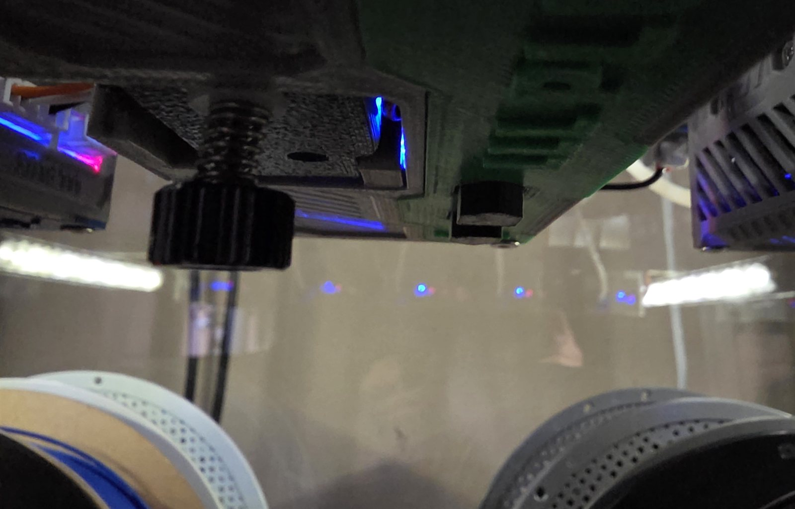

Name credit to u/akir3y on Reddit and chosen based on upvotes.

## Overview

This project is a Voron printer stand that also stores filament. You have options for active dehumidification as well as the ability to feed your Voron (or any other printer really...) from within the stand using a [Filamentalist](https://github.com/Carrot-collective/ERCF_v2/tree/master/Recommended_Options/Filamentalist_Rewinder/Filamentalist_FV3_Rewinder) passive rewinder and an [lll-plus](https://mellow.klipper.cn/en/docs/category/fly-lll-plus-%E7%BC%93%E5%86%B2%E5%99%A8) buffer.

**Quick links:** [Bill of materials and cut lists](StorOn-BOM.xlsx) · [Printed parts (CAD)](CAD) · [ESP32 Inside Cabinet](ESP32%20Inside%20Cabinet/README.md) · [Klipper Macros](Klipper%20Macros/README.md) · [Firmware releases](https://github.com/astechevolves/storon/releases)

**DISCLAIMER:** This is a work in progress, and it is a one-off: my build is serial #1 of 1, and no one else has built one yet. Expect to adjust sizes and parts as you go, and a few BOM items are still unconfirmed (they're marked in the spreadsheet). I am trying to add and make things better one project at a time. Some of what I used was because I already owned it. I have 24V to the buffer, 12V to the lights I'm using, 3V to the micro-dehumidifier, 5V to the ESP32, etc. Things are all over the place because it's what I had in my hand when I was testing and I haven't replaced it. I am hoping I can make a video about this whole assembly in 2027 and we can build one out from scratch. When I do that I'd like to have some more uniformity in power supplies and maybe even do a custom little PCB labelled properly for the functions just to make it easier to build out.

 

 

The frame is cut to the sizes on the cut-list tabs of the [BOM](StorOn-BOM.xlsx) (for example, the vertical corner supports are 31.5 in / 800 mm). At those dimensions there can be 14-16 spools on each drawer (depending on spool width) and I have 2 drawers installed for a total of 28-32 spools of storage. I currently have 5 spools across the top for the toolheads and the buffers are mounted below them. Using [custom lll-plus firmware](#buffers-lll-plus) with I2C controls I am connecting a single USB cable to the Raspberry Pi running Klipper and controlling/monitoring the buffers.

## RFID and Spoolman

RFID reading of spools using an ESP32 inside the cabinet is working on my build but is still being tested, so expect some rough edges. Each lane (the spool feeding a toolhead) gets its own RFID reader, so the stand knows which spool is on which tool and keeps [Spoolman](https://github.com/Donkie/Spoolman) up to date on its own. Full details are in the [ESP32 Inside Cabinet README](ESP32%20Inside%20Cabinet/README.md). The basics are below.

### RFID hardware
- ESP32-S3 DevKitC-1 (N16R8) on a 44-pin screw-terminal breakout.
- One RC522 RFID reader per lane (up to 6 are supported, though fitting 6 in the current frame would be tight), mounted beside the spool facing its side. A ferrite sheet behind each reader keeps it from reading the neighboring spool.
- Readers are wired with two Cat5 cables, each daisy-chained through up to 3 readers. All readers share the SPI bus, and each lane has its own select (SS) pin. Each cable's clock line gets a 39 Ω resistor at the ESP32 end.
- Bambu Lab spools are read straight from their factory tags (read-only). Any other spool gets a 25 mm NTAG215 sticker, written in the open [OpenTag3D](https://opentag3d.info) format from the web UI.
- The same ESP32 also runs the two DHT22 humidity/temperature sensors and the circulation fan.

### Setup basics
1. Flash the prebuilt firmware from [Releases](https://github.com/astechevolves/storon/releases) (no coding needed, but it only works on the **ESP32-S3 N16R8** board), or build and flash it yourself with PlatformIO.
2. Join the `StorOn-Setup-XXXX` WiFi hotspot (password `storonsetup`) and the settings page opens.
3. Enter your WiFi, MQTT broker, Spoolman URL and (optionally) Moonraker URL.
4. Set up the lanes (see below), then **Save and reboot**. The web UI is then at http://filament-monitor.local/ by default (the name follows the device ID).

### Setting lanes
- There are six lane slots; turn on the ones you have readers for. For each one, set its SS pin and which tool (`T0`, `T1`, ...) it feeds.
- Lane numbers stay fixed even when other lanes are turned off, so a lane always means the same physical spot in the cabinet.
- The **Readers** page tests one reader at a time and tells you whether a problem is the wiring or the reader itself. Use it after wiring each lane.

### Spoolman integration
- In Spoolman, first create a **Text** extra field on spools with the key `tag`. This is the same field OpenSpoolMan uses, so spools already set up there will match.
- When a spool is placed in a lane, its tag is matched to a Spoolman spool and that spool's location is set to `StorOn Lane N`. When it's removed, the location is cleared (or set to a location you choose).
- The [Klipper Macros](Klipper%20Macros/README.md) track each tool's loaded/unloaded state. Unloading a tool releases its lane's spool.
- An unknown tag can be linked to an existing spool, or a new spool can be created from the tag data, from the lane's **Spoolman** button on the status page.
- A lane with no tag (for example a bypass feed) can still have a spool: pick one with **Assign spool…** on the status page, or set the spool's location to `StorOn Lane N` in Spoolman.
- Remaining weight comes from Spoolman. If Moonraker's Spoolman integration is set up, Moonraker deducts filament as you print, and the ESP32 re-reads each lane's spool so the weight shown stays current.
- With a Moonraker URL set in the ESP32 settings, each tool's spool is also shared with OrcaSlicer and HelixScreen, and the web UI gets Load/Unload buttons per lane that can be set to custom macros in settings. Load asks which material is going in, so the printer heats to the right temperature.

### Electronics and software
- [ESP32 Inside Cabinet](ESP32%20Inside%20Cabinet/README.md): humidity/temperature monitoring, fan, per-lane RFID spool tags (Bambu and OpenTag3D), Spoolman sync, and a web UI.
- [Klipper Macros](Klipper%20Macros/README.md): tracks each tool's loaded/unloaded state for the ESP32 and blocks prints on unloaded tools.
- OrcaSlicer: the [Orca Spoolman Presets](https://github.com/DIEHARDave/orca_spoolman_presets) plugin (by DIEHARDave) fills the filament slots from the spool loaded on each tool, using the `lane_data` the ESP32 writes.

## Bill of materials

The full parts list, with quantities, specs and prices (as of Nov 2026), is in [StorOn-BOM.xlsx](StorOn-BOM.xlsx). It has three tabs: **BOM**, **Cut List_Extrusion** and **Cut List_Panels**. The priced items add up to about $847, and the polycarbonate and acrylic panels are the biggest cost. Links below are where I bought things. Shop links expire, so the spec is listed beside each one.

## Printed parts

STL and CAD files are in the [CAD](CAD) folder:
- [Back Panels](CAD/Back%20Panels)
- [Buck Converter Mount](CAD/Buck%20Converter%20Mount)
- [DH22 Holder](CAD/DH22%20Holder) (DHT22 sensor holder)
- [ESP32 Mount Puck](CAD/ESP32%20Mount%20Puck)
- [PWM Driver Mount Puck](CAD/PWM%20Driver%20Mount%20Puck)
- [LLL-Plus](CAD/LLL-Plus) (buffer parts)
- [Stand-alone hydrometer mount](CAD/Stand-alone%20hydrometer%20mount)

## Frame and storage

Rack slides: I used rails I had on hand, so the length isn't confirmed yet (marked TBD in the BOM). If I build another one I'll buy a set to test fits. \
2020 aluminum extrusion (about 593 in / 15 m total cut length, from 1220 mm pieces): https://a.co/d/0fAiQeXf \
2040 aluminum extrusion (about 146 in / 3.7 m total cut length): https://a.co/d/03j1iFax \
Corner Brackets: https://a.co/d/0c3Umoue \
3 Side Corners: https://a.co/d/0ic4IAEs \
Profile L Brackets: https://a.co/d/0b12QCzn \
M5 Nuts and Screws: https://a.co/d/0fcr5ywm \
Sealing Foam: https://a.co/d/0fpPBf9j

**Panels:** the side walls, door and lower back are 1/8 in (3 mm) clear polycarbonate. The top and bottom are 1/4 in (5.6 mm) clear acrylic for extra stiffness. Cut sizes are on the **Cut List_Panels** tab.

## Door

Hardware for [Clicky Clack Door](https://github.com/tanaes/whopping_Voron_mods/blob/main/clickyclacky_door%2FREADME.md). I used 3 hinges instead of 2, and the door panel and sealing were longer for the larger door.

Pin Bushings for Clicky Clack: https://a.co/d/01oHRWRj \
Door seal: 2 × MISUMI HSCPF3H-B-2000 (the 2000 is the length in mm)

## Dehumidifier and monitoring

MDL-5 Dehumidifier: https://micro-dehumidifier.com/products-rosahl/membranes/ \
Power for the dehumidifier (3 VDC required): an LM2596 adjustable buck converter set to 3 V: https://a.co/d/0h5Y2pVP

Humidity, temperature and fan monitoring run on the same ESP32 as the RFID readers (see [RFID and Spoolman](#rfid-and-spoolman)). I am publishing MQTT updates to Home Assistant, but how you monitor that data is up to you.

## Buffers (lll-plus)

I use 5 [LLL-Plus Buffers](https://3dmellow.com/products/mellow-lll-plus-filament-buffer-for-diy-3d-printers-klipper-rrf-marlin-material-break-detection-automatic-filament-feeding?VariantsId=10247), either whole and assembled or as a kit where you print your own parts. If you want to assemble it yourself, a good guide was [written here](https://www.teamfdm.com/forums/topic/7953-mellow-fly-lll-pro-filament-buffer/#comment-33137) (it is titled for the LLL Pro, so check it matches your version). \
Wiring breakout for the I2C bus on the buffers: https://a.co/d/03XT3YTJ \
USB-to-I2C adapter (Teyleten CP2112, USB-C) that connects the buffer I2C bus to the Pi \
PTFE Connectors: https://a.co/d/0i8aAcsk

I made the physical changes below and wrote new firmware for I2C control over a single USB connection. The new firmware is in the [lll-buffed repo](https://github.com/astechevolves/lll-buffed).

The first mod was making the buttons taller so you can find them blind by reaching under the buffer, which is mounted facing down.

The second mod was to change the buffer to allow an ECAS connector (the PTFE connectors listed above). The stock PTFE port was very weak, and if the buffer pushed on the filament at all it would push the tubing out of the connector altogether. That was annoying: the buffer would drop, and the filament could feed into the back of the box until the timeout was reached. Not ideal.

The third mod was to install a tougher spring on the buffer tube. The weak spring meant any resistance on the filament between the spool and the print head could cause enough back tension that the filament stops feeding. A strong spring means you are more likely to make it all the way to the head, because it takes more back tension to fully extend the buffer.

## Filamentalist

Hardware for the [Filamentalist Rollers](https://github.com/Carrot-collective/ERCF_v2/tree/master/Recommended_Options/Filamentalist_Rewinder/Filamentalist_FV3_Rewinder). Quantities are in their docs. \
Filamentalist one-way bearings: https://a.co/d/0h9YtOMt \
Filamentalist Springs: https://a.co/d/0beVFlb8 \
608 Bearings: https://a.co/d/0bcoLnwL \
688 Bearings: https://a.co/d/02Pbp8nU

## License

[MIT](LICENSE)
